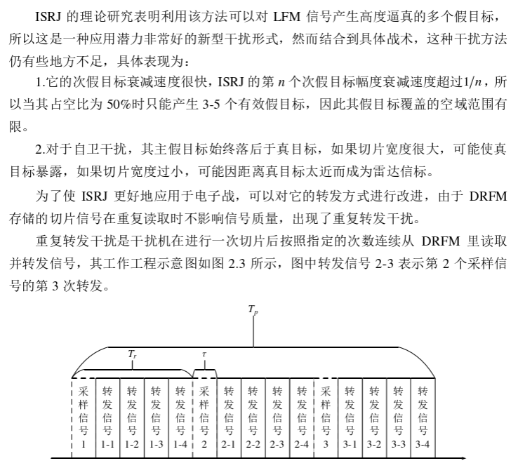
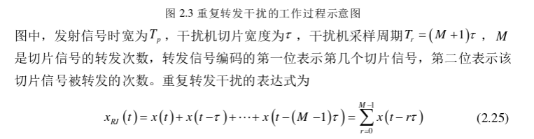
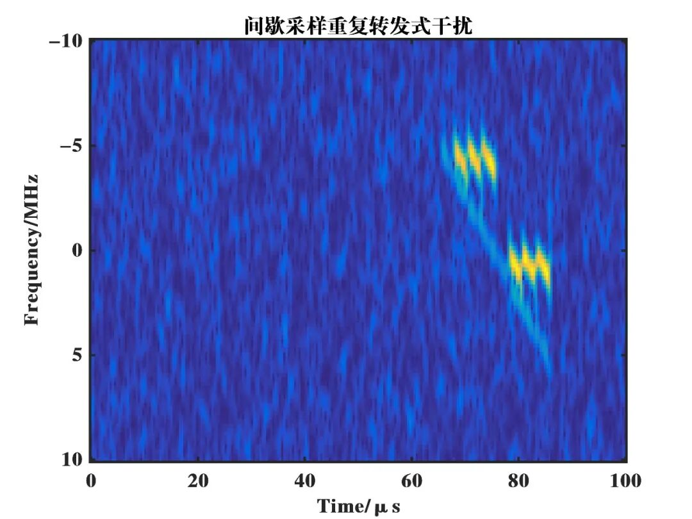
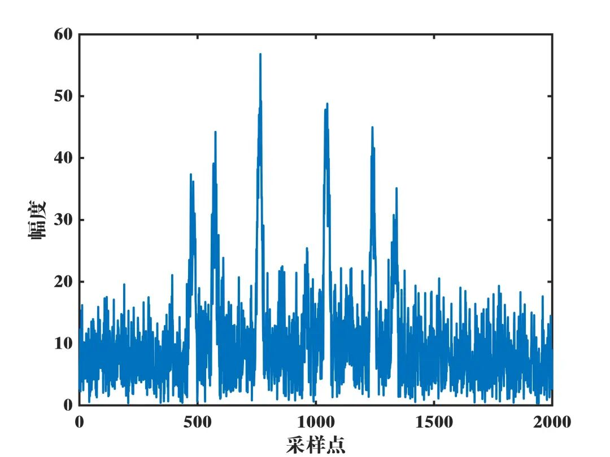
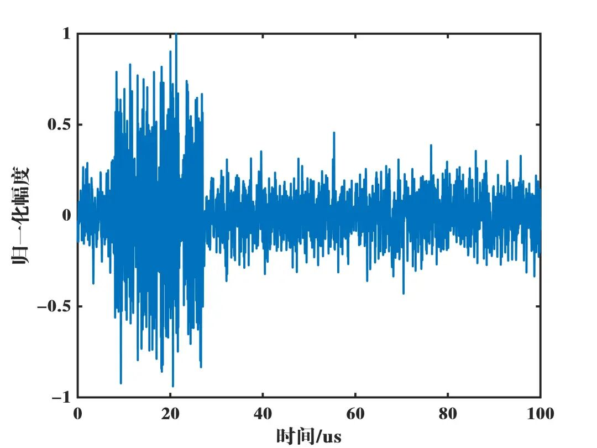

# Radar Jamming - Intermittent Sampling Repetition Forwarding Jamming [with MATLAB Code]

In the field of radar countermeasures, intermittent sampling and repetitive forwarding jamming is an important interference method that significantly affects the detection performance of radar systems. Below, we will briefly introduce its principles.
After sampling is completed, it moves on to the repetitive forwarding phase. The jammer sends out a small segment of signal previously sampled multiple times, according to the set number of repetitions. Assuming the jammer intercepts and samples a radar signal with a duration of τ, then continuously sends this signal out at a repetition cycle Ts. Each time the signal is forwarded, it appears as a return signal from different targets to the radar receiver.
From a principle perspective, this interference method cleverly exploits the characteristics of radar signal processing. When dealing with return signals, radars use matching filters and other means to identify targets. Intermittent sampling and repetitive forwarding jamming signals, after passing through the radar's matching filter, form multiple false target groups in the range direction. Within each false target group, there is a relatively strong main false target, flanked by several secondary false targets on both sides. The appearance of these false target groups makes it difficult for the radar to distinguish between real and fake targets, significantly increasing the difficulty of detecting and tracking targets. For example, in military applications, enemy radars may misidentify a large number of false targets as real targets due to this type of interference, leading to deviations in the detection and tracking of our own real targets, creating favorable conditions for our operational actions.
Main Principles
Simulation Results
Reference: Intermittent Sampling Forwarding Jamming Identification and Combat Technology Research - Wu Yixin
Simulation Environment: MATLAB2016b
End

## Images

<!-- PAYMENT_BLOCK -->

## Get this dataset

- Payment link (Stripe): [Buy now](https://buy.stripe.com/3cs8yP7sY87d0vu9AB)
- Payment QR code: 

<!-- /PAYMENT_BLOCK -->
